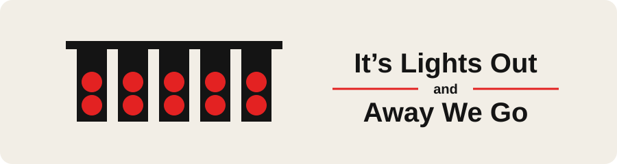

  

  Hello 👋, I'm <b>Gouri Nandana J</b>. Glad you stopped by 💙🏁.

  <a href="https://www.linkedin.com/in/gouri-nandana-j-15a790290/">LinkedIn</a>
  &nbsp;·&nbsp;
  <a href="https://discordapp.com/users/1158281252546285568">Discord</a>

### Stack

**Languages** &nbsp; Python · C · Java · JavaScript · HTML/CSS · SQL 
**Frameworks** &nbsp; Next.js · React · FastAPI · TensorFlow/Keras · Prisma 
**Tools** &nbsp; Git · GitHub · VS Code

<!-- 🚀 Projects section goes here later (add your Markdown links) -->
